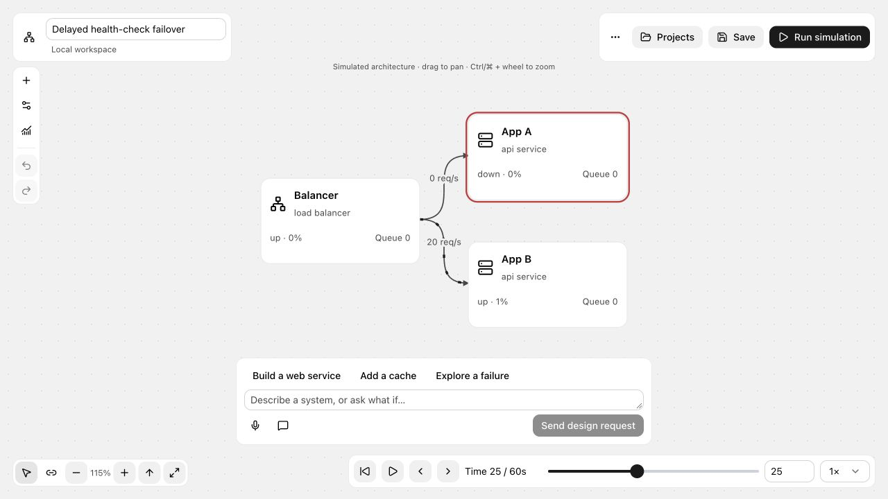
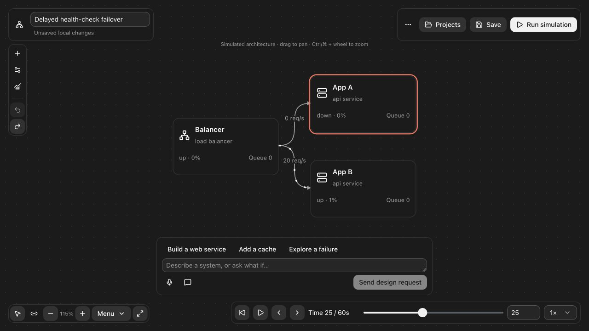
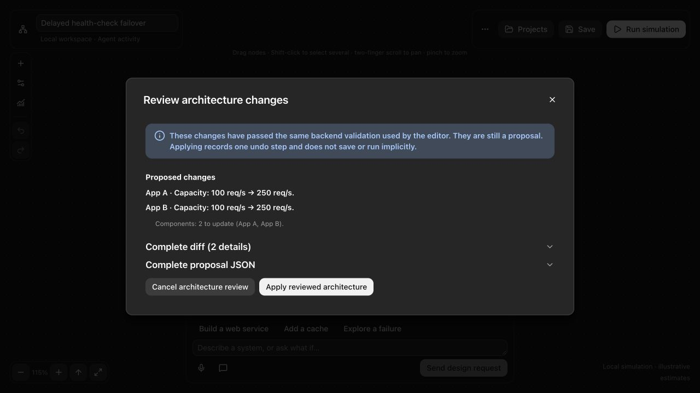

<div align="center">

# Tomorrow’s Design System

**Build an architecture. Simulate a failure. See the trade-offs.**

A local visual workspace for exploring system design, resilience and cost.

[](#project-status) [](#quick-start) [](#quick-start) [](LICENSE)

[Open the app ↗](https://tomorrows-lab.netlify.app/) · [Quick start](#quick-start) · [What you can explore](#what-you-can-explore) · [Example](#watch-a-server-fail) · [Documentation](#documentation) · [Contributing](CONTRIBUTING.md)



*An actual simulated failover experiment in the desktop workspace.*

</div>

## Watch a server fail

Start with a load balancer and two application servers. Send 20 requests per second. At simulated second 15, fail one server. Scrub to second 25 and see the remaining server receiving the traffic.

Change the health-check delay, increase the workload or add a cache. Run again and compare latency, availability, queues and estimated cost against the previous run or a pinned baseline.

The experiment runs locally. The infrastructure is simulated; nothing is provisioned in your cloud account.

<details>
<summary>See the dark workspace</summary>
<br />

</details>

## What you can explore

| Capability | What you can do |
| --- | --- |
| **Visual architecture** | Add, move, connect and configure components on a desktop canvas. The catalog includes 150 types across clients, networking, compute, databases, caching, queues, AI and other system components. |
| **AI-assisted design** | Describe an architecture or a change in text. Review the proposal before applying it. Optional browser dictation lets you speak your request. |
| **Scenario experiments** | Set workloads and seeds. Schedule failures, recovery, traffic changes, latency changes and scaling at a timestamp, within a window or after a metric threshold. |
| **Playback and outcomes** | Play, pause, step and scrub retained simulation frames. Inspect traffic, state, queues, latency, availability and cost. |
| **Cost exploration** | Compare experiment costs and monthly estimates using explicit traffic, operating-hour and rate assumptions. Review cached published prices or use clearly labelled manual estimates. |
| **Reversible exploration** | Undo edits, pin a comparison run, save designs locally and export/import architecture with retained evidence. |
| **Agent-driven testing** | WebMCP-enabled browsers can use 15 tools backed by the same workspace commands as the UI. Compound changes stay in a visible review until explicitly applied. |

## Changes in 0.4.1

The canvas now shows arrivals per simulated second on components and routed calls per second on connections, using the actual interval between retained samples. Replay identifies that interval; Results identifies the whole run. Editing the design hides current graph rates until you simulate again.

Proposal reviews put concrete setting changes before the affected-item inventory and Apply controls. Factory snapshots now enforce fixed input budgets before staging and keep the full audit hash manifest out of the model prompt while retaining it locally. See the [0.4.1 release notes](docs/RELEASE-0.4.1.md) for behavior, verification and limits.

## Quick start

**[Try it in your browser](https://tomorrows-lab.netlify.app/)** — build architectures, configure scenarios, run the same Python simulator, replay traffic and compare costs without installing anything or using AI. Designs and retained runs are stored on your device in this browser; export JSON for a portable backup. The first experiment loads a bundled WebAssembly Python runtime. Browser experiments use explicitly configured rates; AI proposals, live pricing refresh and the development factory require the local edition below. [Browser edition and deployment](docs/BROWSER-EDITION.md).

Requires **Python 3.11+** and a desktop browser, with a target viewport of at least 1100px wide. Prebuilt UI assets are included; Node.js is only needed for frontend development.

From a source checkout:

```sh
cd tomorrows-design-system
python3 -m tds
```

Open **http://127.0.0.1:8765**. If that port is occupied:

```sh
python3 -m tds --port 8766
```

Choose a preset in **Components**, or describe a system in the floating composer. Manual editing and simulation work without an AI account.

AI proposals currently use your installed, authenticated Codex CLI. If you already use Codex through your ChatGPT subscription, the app uses that same CLI login; account access and usage limits still apply. Codex also supports API-key authentication with separate usage-based billing ([official authentication guide](https://learn.chatgpt.com/docs/auth)). Claude Code and OpenCode adapters are planned. Proposals are validated and shown for review; they are never applied automatically. Dictation requires browser support and permission, may use the browser vendor’s speech service, and never submits automatically.

Your designs and run evidence stay under `.tds/`. Set `TDS_DATA_DIR` to use another local directory, or export a design as JSON.

## Make a change, then review it

AI and WebMCP agents can propose several component, connection and scenario changes together. The review shows what will change before Apply. Applying the proposal creates one undo step; it does not run or save implicitly.



WebMCP accelerates command execution. QA still checks the rendered canvas, dialogs, keyboard focus, pointer gestures and layout. The **Agent tools and activity** menu shows browser support and recent outcomes. [Read the observed QA evidence](docs/WEBMCP-QA.md).

## Project status

**Early development.** The local editor, simulated experiments, comparison/history, AI proposal review, pricing/calibration workflows and native WebMCP integration are implemented. Verification includes Python/frontend tests and recorded browser journeys; see the [verification ledger](docs/VERIFICATION.md).

Connection handles work without a persistent tool mode. Shift-click selects several components for group movement, duplication, deletion and shared-property edits. Independent UX/architecture acceptance remains pending. These are tracked in the [experience findings](docs/features/experience-findings.md).

Performance defaults are **illustrative**, not calibrated production predictions. A broad catalog does not mean every provider or component has a measured model. Missing samples remain unavailable, and imported results are labelled unverified external evidence. Calibration needs identifiable measurements for the specific workload.

Price snapshots retain their source, units and retrieval time. OpenRouter prices describe OpenRouter access; they are not direct-provider quotes. Private account quotas, discounts and negotiated rates are not inferred. Monthly estimates are assumption-based projections, not a billing guarantee.

## Documentation

| Start here | Details |
| --- | --- |
| [Architecture](docs/ARCHITECTURE.md) | Simulation, persistence, AI and frontend boundaries |
| [Component and API contract](docs/CONTRACT.md) | Project format, events, results, pricing and calibration |
| [UI system](docs/UI-SYSTEM.md) | Astryx components, desktop layout and interaction rules |
| [WebMCP and QA](docs/WEBMCP-QA.md) | Shared commands, visible reviews, actual checks and limits |
| [Verification](docs/VERIFICATION.md) | Evidence, historical checks and outstanding acceptance |
| [Development factory](docs/FACTORY.md) | Separate standalone CLI workers, scoped tasks, reviews and repairs |
| [Contributing](CONTRIBUTING.md) | Local development, checks and useful issue reports |

## Development

Requires Node.js 22.13+ in addition to Python:

```sh
npm ci --ignore-scripts
npm run build
python3 scripts/check.py
```

The Python backend uses the standard library. The frontend uses React 19, TypeScript and [Astryx’s Neutral theme](https://github.com/meta/astryx). `frontend/` contains source; `web/assets/` contains the built local bundles. Rebuild after UI changes.

The separate `factory/` package coordinates standalone Codex CLI workers with retained feedback and bounded repairs. It is development tooling, not part of the simulation engine. Contributors can edit and test the product directly; running an agent factory is optional.

## License and acknowledgements

[MIT](LICENSE). Built with [Astryx](https://github.com/meta/astryx), React and Lucide. Third-party notices and licenses are recorded in [NOTICE.md](NOTICE.md) and `licenses/`.
